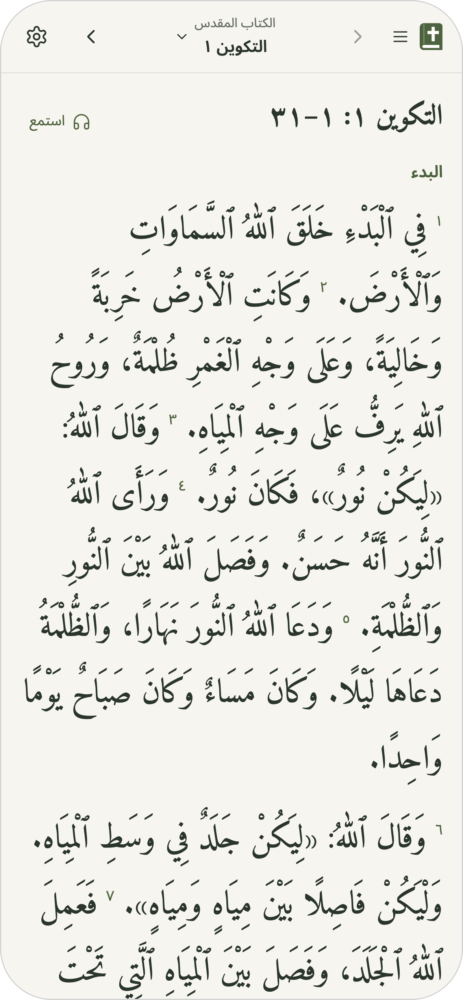

# ChronosBible / «الكتاب المقدس بالترتيب الكرونولوجي»

قراءة واستماع، بالترتيب المعتاد أو الزمني.

An Arabic Bible reader with Scripture given almost the entire screen. Originally built for the youth of the **Brethren Church at Kholousy**, the app offers four reading choices: the whole Bible, self-paced Old and New Testament chronologies, and the 150-day youth plan.

The four-mode release is live at [chronosbible.com](https://chronosbible.com/), and [dev.chronosbible.com](https://dev.chronosbible.com/) previews the `dev` branch. See the [product guide](docs/product.md) for reading choices and compatibility, and the [chronology guide](docs/chronology.md) for the reviewed source audit.

[Open the app](https://chronosbible.com/) · [Development guide](docs/development.md) · [Data sources](data/SOURCES.md)

[](https://github.com/albert429/ChronosBible/actions/workflows/checks.yml)

## Reading experience

- One slim, sticky toolbar; the rest of the page is for reading.
- Clear Arabic text in Amiri, adjustable from 22–38px, with light and dark themes.
- Original passage order, Scripture section headings, verse numbers, and quick passage jumps.
- Four menu choices: «الكتاب المقدس» (66 books in the usual order), «العهد القديم بالترتيب الزمني» (412 self-paced readings), «العهد الجديد بالترتيب الزمني» (141 self-paced readings), and «العهد الجديد في ١٥٠ يومًا» — خطة شباب كنيسة الإخوة بخلوصي.
- A fresh reader opens Genesis 1. Guests and named readers have independent places and explicit completion for each mode; passage links override saved places and support Back/Forward.
- The youth plan keeps its personal start date and 150-day calendar; its day menu jumps to any of the 150 days. Version 2 JSON backups retain places and progress, with migration and import support for version 1 youth-plan data.
- A reading streak counts consecutive days with a completed reading in any track, forgiving one missed day a week. It is shown in the menu, the plan's day menu and calendar, and under a completed reading, with light, motion-safe milestone moments.
- Static frontend hosting, daily reading caches, nearby readings prepared in the background, and secondary screens loaded on demand.
- Optional listening through one native audio player, using 48 kbps mono AAC chapters, daily tracks, and chronology playlists. Nothing audio is fetched until the reader taps Listen; files are immutable and reused by the browser, and a clip shared by several readings is stored once.

<p align="center">
  
</p>

## Made for daily reading together


Developed by **Albert Alfred** for the youth of the Brethren Church at Kholousy.

Contact: [albertalfred429@gmail.com](mailto:albertalfred429@gmail.com) · GitHub: [albert429](https://github.com/albert429)

The banner and community illustration are generated artwork. The mobile screenshot shows the actual app. [Artwork prompts and provenance](docs/design/image-prompts.md) are included in the repository.

## Run locally

Use **Node.js 22** and npm. No credentials or environment variables are required. The optional AI explanations need an OpenRouter key; see the [development guide](docs/development.md#ai-explanations-optional).

```sh
npm ci
npm run dev
```

Open `http://localhost:5173`. Development and production builds automatically generate the static reading files from `data/plan.json`.

```sh
npm run validate                    # Formatting, unit/data tests, production build
npx playwright install chromium webkit
npm run test:e2e                    # Build, then mobile Chromium + WebKit, including accessibility
npm start                           # Preview the production build on port 4173
```

## Hosting and privacy

React, TypeScript, and Vite build a static `dist/` directory. Vercel settings are checked into `vercel.json`; use the Vite preset and `npm run build`. The app requires no backend, database, or public API.

Progress and appearance preferences stay in the current browser. There is no automatic account sync or live group tracking. Backups contain the reader's name, start date, saved places, completion records and the dates readings were completed; keep them private. Readings need a network connection on their first fetch; the app does not currently provide persistent offline access.

The optional AI explanations («اسأل الذكاء الاصطناعي») are off unless a deployment enables them. When a reader uses them, after a one-time notice, the verse, its context and any question they type go to OpenRouter and the model's provider, which may keep the text and train on it. The reader's name and progress are never sent. The key is public by design, so it is limited to free models and a $0 credit limit; see the [development guide](docs/development.md#ai-explanations-optional).

See the [development guide](docs/development.md) for architecture, deployment troubleshooting, source regeneration, and performance checks. Please read [CONTRIBUTING.md](CONTRIBUTING.md) before making changes.

Listening is built offline and served as separately hosted static audio: the New Testament is a dramatised Van Dyck recording and the Old Testament a non-dramatic one, both distributed by Faith Comes By Hearing (credits in the app's About and in [audio provenance](data/audio/SOURCES.md)). The integration covers 1,189 canonical chapters, the 150 retained daily tracks, 553 chronological playlists (412 Old Testament, 141 New Testament) and 1,095 deduplicated 48 kbps mono AAC clips. The recordings keep their own native introductions; no spoken labels are generated. A reading shows Listen only when every file it needs is in the verified publication inventory, so unfinished uploads never appear as broken buttons. The complete release is 2,435 files (1,189 chapter recordings + 150 daily + 1,095 clips + 1 superseded Job 36 file kept for rollback); all passed live byte-range verification and are recorded in the publication inventory. Playback was checked in Chrome (and Genesis 1 in WebKit); the user confirmed on a physical Android Chrome device that audio keeps playing while the screen is locked and passages advance, and a physical iPhone remains unverified. The machine alignments are not a listening review; see the [audio guide](docs/audio.md) for the evidence boundary, publication gate, staged release and bandwidth estimates. Audio recording rights are separate from the public-domain Scripture text; consult the provenance and applicable recording terms.

## Scripture attribution and rights

The bundled Scripture is the **Arabic Van Dyck / فان دايك, eBible.org `arb-vd` edition**. eBible.org identifies this edition as **public domain**. Translation is credited to the Syrian Mission, with the American Bible Society listed as a contributor. This project claims **no copyright over the Scripture text**. This statement applies to the identified source edition; it does not make a claim about every modern Bible edition or its editorial material. [Source and rights statement](https://ebible.org/bible/details.php?id=arb-vd).

Amiri and Noto Sans Arabic are distributed under the SIL Open Font License 1.1. See [THIRD_PARTY_NOTICES.md](THIRD_PARTY_NOTICES.md) for the separate terms covering Scripture, fonts, and artwork.

## License

Copyright (C) 2026 Albert Alfred. The code and other original project content are licensed under the [GNU AGPL-3.0-or-later](LICENSE). Anyone who runs a modified version for users over a network must offer those users its source.

Not covered, and keeping their own terms (see [THIRD_PARTY_NOTICES.md](THIRD_PARTY_NOTICES.md)): the public-domain Van Dyck Scripture text and other Scripture and study sources, the fonts (SIL OFL), third-party software and marks (eBible.org, the React logo), and the church logo and reading-plan document, which are not licensed for reuse.

---

<p>
  <sub> Built using <a href="https://react.dev/">React</a><br />
  Scripture data courtesy of <a href="https://ebible.org/bible/details.php?id=arb-vd">eBible.org</a> — Arabic Van Dyck, public domain.</sub>
</p>
